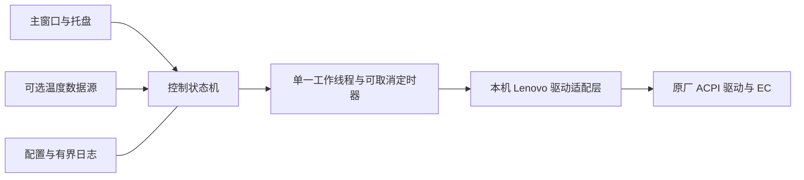

# FanController 项目实施计划

版本：v1.0 · 日期：2026-09-27 · 目标平台：本机 Windows 10 x64

目标是为这台联想电脑开发一款中文原生桌面风扇控制软件：启动时使用原厂自动控温，支持手动档位、托盘与可选自启动，视觉参考 NitroSense 的控制台布局，并以低资源占用和长期稳定运行作为发布条件。本轮交付为计划与研究记录，尚未实现软件。

## 1. 已确认的需求与设备边界

| 项目 | 已确认内容 |
| --- | --- |
| 本机 | Lenovo ideapad 720S-13ARR，机型 81BR |
| 平台 | AMD Ryzen 7 2700U / Radeon Vega 10；Windows 10 家庭版 19045 x64 |
| 固件 | BIOS 6KCN40WW |
| 原厂驱动 | Lenovo ACPI-Compliant Virtual Power Controller，15.11.29.70，已签名且运行中 |
| 参考工具 | 用户已确认 LenovoFanControl-x64.exe 在本机能够改变风速 |
| 启动行为 | 用户已确认：每次新启动都先由原厂 BIOS/EC 自动控制，不恢复上次手动档位 |
| 首版范围 | 用户已确认：原厂自动＋手动档位，稳定性和低占用优先 |
| 自启动 | 提供开关，默认关闭；开启后在用户登录时启动到托盘 |
| 视觉 | 借鉴 NitroSense 的深色面板、清晰状态区和突出模式选择的编排 |

参考工具支持低速、正常、高速三种策略，底层只有正常和强冷两类命令，低速由周期性发送正常命令实现。它没有提供任意 RPM、连续 PWM 百分比或独立风扇控制接口。因此，首版以真实有效的档位控制为基线；精确转速、每个风扇分别控制和风扇曲线须有新的硬件证据才能加入。[上游说明](https://github.com/jiarandiana0307/Lenovo-Fan-Control)、[控制源码](https://github.com/jiarandiana0307/Lenovo-Fan-Control/blob/c808102a0eddc6fecbe86dafa164188f750beac6/src/fanctrl.c)

## 2. 首版功能清单

| 功能 | 首版设计 | 验收要求 |
| --- | --- | --- |
| 正常／原厂自动 | 默认模式，停止手动维持逻辑并发送经验证的恢复命令 | 新启动、退出、恢复流程均不遗留手动任务 |
| 强冷／高速 | 按该机型验证过的时序维持强冷 | 切换可取消；失败时停止重试并报告真实状态 |
| 低速 | 纳入研究与界面设计，通过温度保护和恢复验证后才开放 | 不以“正常命令成功”冒充低速已经实现 |
| 状态展示 | 控制模式、正在应用／已确认／失败、驱动连接情况 | 区分用户选择、驱动回执与真实传感器读数 |
| 转速／温度 | 有可靠数据时显示数值和更新时间；没有时显示“未提供” | 不显示模拟 RPM，不把未知值当成 0 |
| 托盘 | 显示主窗、切换可用模式、恢复自动并退出 | 隐藏窗口后仍可操作，后台不持续绘图 |
| 自启动 | 登录启动、默认原厂自动、默认隐藏主窗 | 可开启、关闭；安装路径改变后能修复或明确报错 |
| 设置 | 自启动、关闭窗口行为、可选快捷键、诊断导出 | 不保存可在下次启动自动应用的低速／高速状态 |
| 单实例 | 同一机器只允许一个本软件控制者 | 重复启动激活现有会话，不创建第二套控制循环 |

“每次启动”指建立新的控制会话。托盘重新显示窗口或重复启动激活现有会话，只显示当前运行状态；软件退出后重新启动、自启动及异常重启，均重新从原厂自动模式进入。

窗口关闭按钮默认最小化到托盘；菜单中的“恢复自动并退出”先恢复原厂控制再结束程序。首次关闭时给一次简短托盘提示，避免误以为程序已经退出。

## 3. 技术方案

推荐采用 **C++20 + Win32 + GDI/GDI+ + CMake + MSVC x64**。使用系统控件与有限自绘实现深色控制面板，保留系统文字渲染、键盘导航和 DPI 适配。这个组合便于严格管理驱动句柄、线程和绘图资源，也适合小体积、事件驱动的常驻程序；实际占用以本机测量为准。

首版运行时为一个进程、一个 UI 线程和一个控制工作线程；系统库可能另建线程，验收同时记录总线程数。绘制由窗口损坏或数据变化触发，静止界面不运行帧循环，托盘状态暂停界面刷新。[Windows 绘制机制](https://learn.microsoft.com/en-us/windows/win32/gdi/wm-paint)



| 模块 | 职责 |
| --- | --- |
| `ui` | 窗口、模式卡片、状态展示、托盘与无障碍交互 |
| `core` | 模式状态机、命令优先级、失败处理、温度保护和生命周期 |
| `hardware` | Lenovo 接口封装、能力识别、调用结果校验；只允许已验证命令 |
| `platform` | 自启动、实例互斥、休眠／唤醒通知、原子配置写入 |
| `diagnostics` | 有界日志、错误汇总、性能采样与导出 |
| `tests` | 模拟驱动、故障注入、状态机和资源生命周期验证 |

界面向状态机提交“切换模式”，不直接操作驱动。所有驱动操作由一个工作线程串行执行；连续点击合并为最新目标，恢复自动和退出请求具有最高优先级。使用事件或可等待定时器等待，避免忙循环和每次切换新建线程。[Windows 定时器文档](https://learn.microsoft.com/en-us/windows/win32/winmsg/about-timers)

先验证普通用户能否访问现有驱动；确需提升权限时，再采用受控提权和任务计划程序。默认不增加常驻 Windows 服务。若异常退出实验表明原厂 EC 不能可靠恢复，评估仅在手动模式运行的恢复辅助进程，或者收缩该模式能力；辅助进程占用计入软件总预算。

## 4. 控制状态与恢复行为

核心状态为：初始化、原厂自动、应用中、强冷、低速、恢复中、故障／状态未知。初始化成功前禁用手动操作。

| 场景 | 预期行为 |
| --- | --- |
| 首次启动、自启动、进程重启 | 获取控制权 → 识别机型和驱动 → 恢复正常 → 验证回执 → 开放手动模式 |
| 主窗隐藏到托盘 | 维持本次会话所选模式，停止 UI 绘图 |
| 用户点击原厂自动 | 取消全部手动定时任务，串行恢复正常；失败时显示“恢复未确认” |
| 正常退出 | 停止接收新命令，取消工作，恢复正常，释放全部资源 |
| 即将休眠／系统注销 | 在系统允许的时间内尝试恢复，不以无限等待阻塞系统 |
| 唤醒 | 重新验证驱动，重新进入原厂自动，不恢复先前手动模式 |
| 驱动调用失败 | 有界重试；停止手动维持，尝试恢复，保留明确错误状态 |
| 温度读取过期、失败或超过已验证阈值 | 退出低速并交回原厂控制；只在已验证的条件下临时强冷 |
| 配置损坏 | 使用默认配置；启动仍为原厂自动 |
| 其他控制工具正在使用设备 | 避免竞争写入，提示关闭冲突程序，不结束其他软件进程 |

原程序的状态查询首次执行会先发送正常命令。新实现应把初始化恢复与纯状态查询分开，避免监测本身反复修改硬件。每次调用都校验 API 返回值、错误码、返回长度和状态有效性。

进程被强制结束时，退出回调无法保证执行；线程超时也不能保证底层驱动调用可以取消。因此需要在本机验证停止维持命令后的固件恢复时间，以及驱动异常时的表现。只有证据充分的恢复行为才写入最终产品说明。

低速模式的发布条件是：真实风速效果得到确认、可靠温度来源及失效回退已验证、恢复路径有效。普通 ACPI 热区读数不能直接当作 CPU 核心温度。条件不满足时，交付原厂自动＋强冷，界面说明低速暂不可用；不因此阻塞核心版本，也不把未经验证的低速功能标为完成。

## 5. 界面编排

以“打开即可看懂当前模式，一次点击完成切换”为原则。参考 NitroSense 的监测区与控制区分工，按本机实际可用能力组织内容。[Acer 官方介绍](https://community.acer.com/en/kb/articles/78-nitrosense-software)

| 区域 | 内容与视觉 |
| --- | --- |
| 顶栏 | 应用名、设备名、连接状态、设置入口；保留清晰的窗口操作 |
| 主状态区 | 大字号“原厂自动／强冷／低速”，静态风扇图形，正在应用或失败提示 |
| 模式区 | 正常、强冷、低速三张模式卡；不可用卡片显示具体原因 |
| 信息区 | 温度与 RPM 按能力展示；无数据时用状态信息替代空仪表 |
| 底栏 | 自启动状态、“恢复自动并退出”、最近操作结果 |
| 设置面板 | 自启动、托盘、快捷键、诊断；低频操作收进此处 |

建议配色：背景 `#101318`，面板 `#1B222C`，主文字 `#F2F4F7`，正常模式青绿色，强冷橙红色，异常琥珀色。优先使用系统字体、矢量或程序绘制的静态图形；不安排持续旋转的风扇、粒子、视频背景或持续模糊特效。

主窗逻辑尺寸约 900×580，并按系统工作区缩放布局；验证 100%、125%、150%、200% DPI、键盘焦点和屏幕阅读器可识别名称。图标和颜色以文字辅助。未确认可分别控制风扇前，界面只展示一个风扇组。

## 6. 资源占用与内存验收

以下为首版工程目标，尚非实测结果。统计软件及其辅助进程的总量。使用 Release x64，在本机预热 5 分钟后按 1 秒间隔采样至少 10 分钟；CPU 百分比按整机逻辑处理器总容量归一化。

| 指标 | 目标 |
| --- | --- |
| 托盘、原厂自动 | 平均 CPU ≤0.1%；Private Bytes ≤20 MiB |
| 托盘、手动控制 | 平均 CPU ≤0.2%；Private Bytes ≤25 MiB |
| 主窗可见、静止 | 平均 CPU ≤0.5%；Private Bytes ≤35 MiB |
| GPU | 托盘不提交界面绘制；静止主窗无持续绘制；记录进程 GPU 与系统桌面合成影响 |
| 工作集 | 与 Private Bytes 同时记录；不通过强行清空工作集美化数据 |
| 启动 | 本机目标 1 秒内显示可交互窗口；驱动检查异步完成 |
| 安装体积 | 首版程序与静态资源目标 ≤10 MiB，不含调试符号 |
| 日志 | 单文件 ≤2 MiB，最多 3 份；重复故障限频，内存队列设上限 |

若加入传感器采样，其成本计入以上预算；只有真实温度存在时才安排刷新。窗口可见时最多 1 Hz 更新显示，隐藏后停止显示刷新；处于低速保护时，温度检查保持经验证的频率。控制维持时序不随 UI 刷新频率改变。

“无内存泄漏”落实为工程约束和持续验收：

1. 使用 RAII 管理设备句柄、线程、事件、字体、画刷、位图、托盘图标和 COM 对象；资源所有者明确，退出路径可验证。
2. 命令队列、日志、历史数据和绘图缓存都有容量边界；模式切换不积累线程、回调或订阅。
3. 使用 Application Verifier 检查堆、句柄和锁；AddressSanitizer 检查越界及释放后使用；使用 UMDH 堆快照差分定位未释放分配。ASan 结果不代替泄漏检查。[AppVerifier](https://learn.microsoft.com/en-us/windows-hardware/drivers/devtest/application-verifier)、[ASan](https://learn.microsoft.com/en-us/cpp/sanitizers/asan?view=msvc-170)、[UMDH](https://learn.microsoft.com/en-us/windows-hardware/drivers/debugger/using-umdh-to-find-a-user-mode-memory-leak)
4. 模拟驱动完成 10,000 次模式转换，UI 完成 1,000 次显示／隐藏与设置开关；比较回到相同状态时的堆、句柄、GDI/USER 对象与线程数量。
5. 完成 24 小时初测和 72 小时发布前连续运行；预热后内存不随时间或操作次数持续增长，差分分配必须可解释。24 小时同状态 Private Bytes 中位数增长超过 3 MiB 触发调查；即使低于阈值，可重复确认的泄漏也阻止发布。

资源测量使用未插桩的 Release 构建，内存诊断使用独立诊断构建。长测是发布证据，不能把有限测试表述为数学意义上的绝对零泄漏。

## 7. 自启动、配置与打包

自启动定义为当前用户登录后启动，登录前由固件管理风扇。优先使用当前用户的任务计划程序任务；权限级别由驱动访问验证结果决定。需要最高权限时，在开启设置时按 Windows 机制完成提升；不保存用户密码。[任务安全上下文](https://learn.microsoft.com/en-us/windows/win32/taskschd/security-contexts-for-running-tasks)

任务使用固定安装路径和仅隐藏主窗的启动参数，启动模式在程序内固定为原厂自动。关闭开关、卸载和更新只维护本软件自己的任务；界面读取任务实际状态，注册失败时不显示“已开启”。

配置保存在当前用户的本地应用数据目录，采用带版本号的格式和原子替换。只保存界面与启动偏好。发布便携包和可卸载安装包，包含版本信息、必要的开源声明与诊断说明；默认离线工作，首版不加入联网账户或自动更新常驻程序。若采用上游代码，保留其 MIT 许可与版权声明。

## 8. 实施顺序与交付物

按单人开发估算，核心版本约 8–12 个有效开发日，另留 72 小时连续运行验证；低速温度来源、驱动异常恢复或精确转速研究可能增加工期。每阶段以验收证据结束，预计时间不等于完成承诺。

| 阶段 | 工作与交付 | 完成条件 |
| --- | --- | --- |
| M0：范围与研究 | 本计划、硬件快照、参考软件源码评估 | 已完成；用户三项边界已确认 |
| M1：硬件可行性，1–2 日 | 本机适配报告、最小控制验证器、模式／回读／权限／恢复矩阵 | 正常和强冷有效；低速条件明确；故障或退出后状态可解释 |
| M2：核心控制，2–3 日 | 驱动适配层、状态机、单工作线程、取消与恢复、模拟驱动测试 | 无无限重试、无并发写入；启动与退出策略通过验证 |
| M3：原生界面，2–3 日 | NitroSense 风格主窗、托盘、可用模式、中文错误提示 | DPI 与键盘操作正常；界面信息对应真实能力；初步占用达标 |
| M4：自启动与集成，1 日 | 设置持久化、自启动、休眠恢复、冲突处理、安装卸载 | 重启登录正常；开关与真实任务一致；更新不恢复手动档位 |
| M5：稳定性与发布，2–3 日＋长测 | 性能报告、泄漏检查、连续运行记录、安装／便携包和使用说明 | 所有核心验收通过；已知限制和实测数据写入发布说明 |

M2 依赖 M1 确认的命令和恢复方案。M3 可在接口冻结后使用模拟驱动开发。M4、M5 必须用真实驱动完成集成验证，不能只用界面演示替代。

## 9. 验证范围与发布门槛

| 类型 | 验证内容 |
| --- | --- |
| 状态机测试 | 初始自动、连续切换、取消、退出优先、回执延迟、恢复失败 |
| 驱动故障模拟 | 打开失败、IOCTL 失败、返回长度不符、未知状态、调用阻塞 |
| 配置与启动 | 首次运行、损坏配置、重复启动、登录启动、普通用户／提权环境 |
| 电源生命周期 | 插拔电源、睡眠、休眠、唤醒、注销和重启 |
| 界面与资源 | 缩放、键盘操作、重复打开关闭、托盘恢复、长时间运行 |
| 本机实际风速 | 正常／强冷／有条件低速的实际效果、稳定性、恢复时间；无转速传感器时记录可验证的观察方式并注明测量限制 |

大量重复切换和失败注入在模拟后端完成。真实硬件测试采用有间隔的操作和温度观察，验证实际效果，不用高频写硬件进行压力测试。

发布必须满足：启动自动、手动切换确实生效、正常退出恢复可验证、失败时状态真实、资源达到预算、无已发现而未修复的泄漏。低速、RPM、温度等能力若不满足条件，应明确列为未开放或未提供。

当前尚需通过实现阶段实验解决的技术问题是：温度与转速是否有轻量可靠来源、低速是否可受保护地使用、异常终止后的 EC 恢复时间、驱动是否要求管理员权限。这些已有明确的验证阶段，不需要现在追加产品偏好确认。

## 10. 建议目录

以下目录在进入开发阶段时建立；当前仅生成计划和研究文件。

```text
FanController/
  PLAN.md
  RESEARCH.md
  CMakeLists.txt
  CMakePresets.json
  src/
    app/
    ui/
    core/
    hardware/
    platform/
    diagnostics/
  resources/
  tests/
    unit/
    integration/
    soak/
  tools/
  packaging/
  docs/
    hardware-support.md
    verification-report.md
  third_party/
    notices/
```

本机硬件、参考文件校验及源码问题的可追溯记录见 [RESEARCH.md](RESEARCH.md)。
